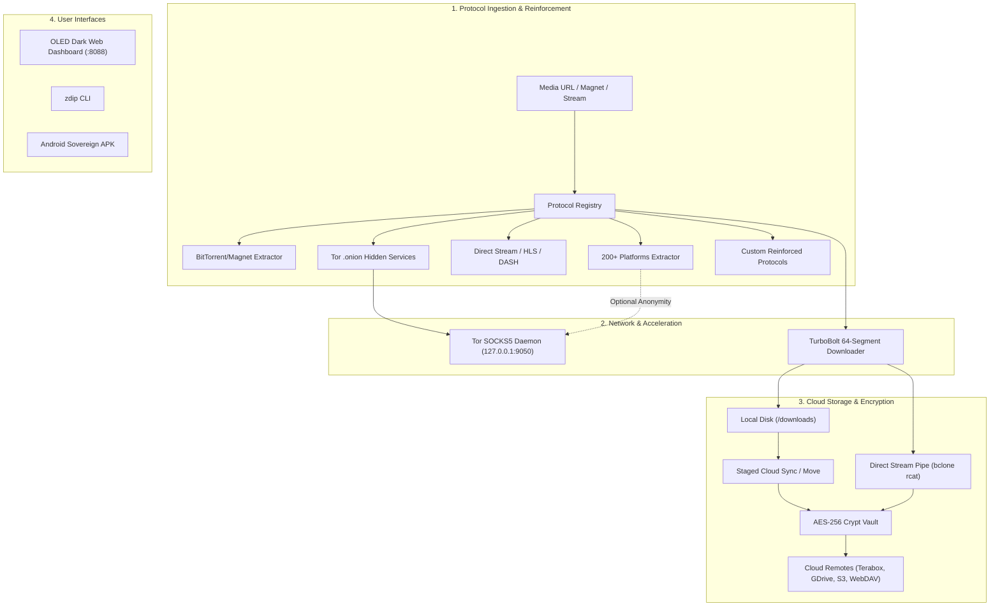

# :zap: Z.Dip - Sovereign Video & Cloud Engine

<p align="center">
  <strong>Extract videos from torrents and 200+ platforms directly to cloud storage with custom support for reinforcing new protocols.</strong>
</p>

<p align="center">
  <a href="https://github.com/mayankreseracher/Z.Dip/releases/latest"></a>
  <a href="LICENSE"></a>
  <a href="https://python.org"></a>
  <a href="android/"></a>
  <a href="docs/ARCHITECTURE.md"></a>
  <a href="docs/CLOUD_STORAGE.md"></a>
</p>

---

## :sparkles: Overview

**Z.Dip** (Zytor Sovereign) is a privacy-first, protocol-reinforceable media ingestion and cloud pipeline. It bridges decentralized P2P BitTorrent swarms, 200+ video streaming platforms, Tor onion routing, and multi-cloud storage into a unified ecosystem accessible across Desktop, Server, Docker, and Mobile (Android).

Whether you want to stream a 50GB 4K video directly into a zero-knowledge encrypted Terabox or Google Drive vault without consuming local disk space, route traffic through Tor, or reinforce extraction rules for new protocols, Z.Dip provides the complete toolchain.

---

## :rocket: Key Innovations

### 1. :magnet: BitTorrent & Magnet Swarm Extraction
- Natively parses BitTorrent Magnet URIs (`magnet:?xt=urn:btih:...`) and `.torrent` files.
- Extracts swarm info hashes, active trackers, file trees, and webseed mirrors.
- High-speed swarm downloading via aria2 integration and WebSeed acceleration.

### 2. :clapper: Universal 200+ Web Platforms (yt-dlp Engine)
- Extracts video streams across **YouTube, Twitch, TikTok, Instagram, Twitter/X, Reddit, Vimeo, SoundCloud, Bilibili, Dailymotion**, and 200+ other providers.
- Full resolution gamut: `8K | 4K | 2K | 1080p FHD | 720p HD | Audio (FLAC, MP3 320k, WAV, OPUS)`.
- Automatic subtitle scraping, thumbnail embedding, and metadata enrichment.

### 3. :jigsaw: Protocol Reinforcement Framework
- **Dynamic Rule Reinforcement:** Inject custom HTTP headers, user-agents, authentication cookies, proxy tunnels, or P2P trackers into active protocol extractors at runtime without restarting services.
- **Pluggable Architecture:** Add support for proprietary or emerging media protocols (WebRTC, RTSP, IPFS, Arweave) in under 50 lines of Python using the `@register_protocol` decorator.

### 4. :cloud: bclone Multi-Cloud Bridge & Zero-Disk Streaming
- **Direct-to-Cloud Zero-Disk Streaming (`rcat`):** Streams network data directly through an in-memory pipe into remote cloud storage -- **zero bytes consumed on physical local storage**.
- **Staged Cloud Sync / Move:** Downloads at maximum TurboBolt speeds locally, then automatically synchronizes to cloud remotes (with optional local deletion).
- **Supported Remotes:** Terabox (1TB+ free), Google Drive, Microsoft OneDrive, Mega.nz, Amazon S3, Cloudflare R2, MinIO, WebDAV (Nextcloud), AList, AllDebrid, TelDrive, SFTP, and FTP.

### 5. :lock: Client-Side AES-256 Crypt Vaults
- Wrap any cloud provider with an encrypted virtual remote using **AES-256-GCM**.
- Encrypts file payloads and folder/file directory names before they leave your device.
- Cloud providers only ever store scrambled ciphertext -- zero-knowledge privacy guaranteed.

### 6. :onion: Native Tor Onion Routing & Anonymity
- Integrated SOCKS5 proxy engine (`socks5://127.0.0.1:9050` / `9150`).
- Resolves and extracts video feeds from `.onion` hidden services while bypassing geo-blocking and ISP throttling.
- **1-Click Identity Rotation:** Sends `SIGNAL NEWNYM` to switch Tor circuits and obtain a fresh exit IP instantly.

### 7. :zap: TurboBolt 64-Segment Engine
- Extreme multi-threaded parallel downloading supporting up to **64 segments** and **32 concurrent connections**.
- Automatic retry with exponential backoff and real-time WebSocket progress broadcasting.

### 8. :iphone: Android Sovereign Edition (`.apk`)
- Native ARM64 `libbclone.so` binary embedded in `lib/arm64-v8a/`.
- Dalvik smali bytecode patches for automatic background upload upon task completion and Tor proxy auto-routing.
- Pre-compiled, aligned (4-byte), and cryptographically signed with V1, V2, and V3 schemes.

---

## :triangular_ruler: System Architecture



---

## :rocket: Quick Start Guide

### 1. Web Dashboard (Recommended)

#### Windows
Double-click `start_zdip.bat` (or run `python -m zdip.server`).
Your browser will open automatically at **`http://127.0.0.1:8088`**.

#### Linux / macOS
```bash
# Clone repository
git clone https://github.com/mayankreseracher/Z.Dip.git
cd Z.Dip

# Install dependencies
pip install -r requirements.txt
pip install -e .

# Launch server
zdip serve --port 8088
```

---

### 2. Command Line Interface (CLI)

```bash
# Extract streams from a Magnet link or video URL
zdip extract "magnet:?xt=urn:btih:d2474e86c95b19b8bcfdbb7242f830467d755bc2..."
zdip extract "https://www.youtube.com/watch?v=dQw4w9WgXcQ"

# Download video with 16 parallel segments and sync to Terabox
zdip download "https://example.com/video.mp4" --cloud terabox --dest-folder "Movies"

# Download anonymously through Tor proxy
zdip download "https://example.com/video.mp4" --tor --segments 32

# Inspect or rotate Tor identity
zdip tor --status
zdip tor --rotate
```

---

### 3. Docker Deployment

Deploy Z.Dip with a single command:

```bash
docker compose -f docker/docker-compose.yml up -d
```
Access the web dashboard at `http://localhost:8088`.

---

### 4. Android Sovereign APK

Download the latest signed package directly from GitHub Releases:

:package: **[Download zytor-sovereign-v1.2.0.apk](https://github.com/mayankreseracher/Z.Dip/releases/latest)**

Install via ADB:
```bash
adb install -r zytor-sovereign-v1.2.0.apk
```
*For bytecode smali patches and reverse engineering details, see the [`android/` directory](android/).*

---

## :jigsaw: Protocol Reinforcement in 30 Seconds

Reinforcing an existing protocol or registering a new custom protocol is trivial:

```python
from zdip.protocols import register_protocol, BaseProtocolExtractor, ExtractionResult, StreamQuality

@register_protocol
class CustomStreamExtractor(BaseProtocolExtractor):
    def __init__(self):
        super().__init__(name="CustomLiveStream", priority=25)

    def can_handle(self, url: str) -> bool:
        return url.startswith("custom-live://")

    def extract(self, url: str, options=None):
        return ExtractionResult(
            success=True,
            protocol=self.name,
            url=url,
            title="Reinforced Live Stream",
            media_type="stream",
            video_qualities=[
                StreamQuality(format_id="hd1080", label="1080p HD", direct_url=url).to_dict()
            ]
        )
```
*For deep-dive documentation, see [docs/PROTOCOL_REINFORCEMENT.md](docs/PROTOCOL_REINFORCEMENT.md).*

---

## :file_folder: Repository Layout

```
Z.Dip/
+-- .github/workflows/          # CI testing & Release build automation
+-- android/                    # Android Sovereign Edition
|   +-- README.md               # Mobile installation and APK integrity guide
|   +-- patches/                # Pure Dalvik Smali bytecode patches
|   |   +-- BcloneCloudUploader.smali
|   |   +-- DownloaderImpl.smali.patch
|   |   +-- DownloadPreferences.patch
|   |   +-- strings.xml.patch
|   +-- tools/patch_apk.py      # Automated APK decompilation & signing tool
+-- docker/                     # Containerized deployment
|   +-- Dockerfile
|   +-- docker-compose.yml
+-- docs/                       # Comprehensive documentation
|   +-- ARCHITECTURE.md         # Detailed architectural breakdown
|   +-- PROTOCOL_REINFORCEMENT.md # Guide to reinforcing & adding protocols
|   +-- CLOUD_STORAGE.md        # Setting up Terabox, GDrive, and Crypt Vaults
|   +-- API_REFERENCE.md        # REST API & WebSocket event specifications
+-- tests/                      # Pytest automated test suite
+-- zdip/                       # Core Python Package
|   +-- cli.py                  # Unified CLI tool (zdip)
|   +-- config.py               # Portable configuration & binary resolution
|   +-- server.py               # FastAPI + WebSocket asynchronous server
|   +-- core/                   # Core subsystems
|   |   +-- bclone_bridge.py    # Multi-cloud storage & AES-256 Crypt Vault
|   |   +-- download_manager.py # Job queue & event dispatcher
|   |   +-- tor_engine.py       # Tor proxy & circuit isolation
|   |   +-- turbobolt.py        # 64-segment parallel downloader
|   +-- protocols/              # Protocol Reinforcement Engine
|   |   +-- base.py             # Base protocol interfaces & data contracts
|   |   +-- torrent.py          # BitTorrent & Magnet protocol extractor
|   |   +-- web_media.py        # 200+ Video Platforms extractor
|   |   +-- direct_stream.py    # Direct HTTP/HTTPS/HLS/DASH extractor
|   |   +-- onion.py            # Tor .onion Dark Web extractor
|   +-- web/                    # Glassmorphic Dark OLED Dashboard
+-- CONTRIBUTING.md             # Contribution guidelines
+-- LICENSE                     # GNU General Public License v3.0
+-- pyproject.toml              # PEP 621 Python package configuration
+-- requirements.txt            # Production dependencies
+-- requirements-dev.txt        # Development & testing dependencies
+-- start_zdip.bat              # 1-Click portable Windows launcher
+-- README.md                   # This file
```

---

## :lock: Security & Privacy Policy

- **Zero-Knowledge Encryption:** Files encrypted with `crypt` cannot be read by cloud providers without your password and salt.
- **Environment & Secret Protection:** Secrets reside in `.env.local` and are strictly excluded from source control.
- **No Telemetry / No Tracking:** Z.Dip connects only to user-specified remotes and media hosts.

---

## :scroll: License

Distributed under the [GNU General Public License v3.0](LICENSE).
Built upon the foundations of [Zytor](https://github.com/ImKKingshuk/Zytor) and [bclone](https://github.com/BenjiThatFoxGuy/bclone).