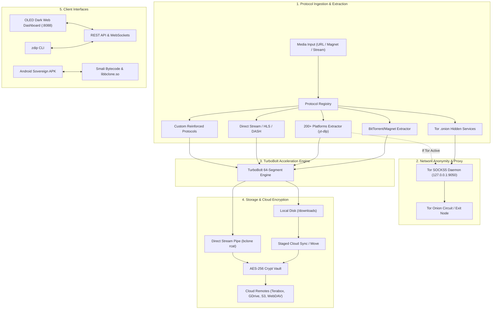

# 🏗️ Z.Dip System Architecture

**Z.Dip** is engineered as a unified, protocol-reinforceable media extraction and cloud pipeline. It decouples media source resolution, high-speed multi-segment downloading, onion network routing, and multi-cloud synchronization into distinct, pluggable subsystems.

---

## 🧩 Architectural Subsystems

### 1. Protocol Ingestion & Reinforcement Engine (`zdip.protocols`)
- **Abstract Base Contract (`BaseProtocolExtractor`):** Every extractor defines `can_handle(url)`, `extract(url, options)`, and `reinforce(custom_rules)`.
- **Dynamic Precedence Ordering:** Extractors register with priority values (lower values execute first). For example, BitTorrent Magnet URIs (`priority=10`) and Tor Onion links (`priority=20`) take precedence over generic web extractors.
- **Runtime Reinforcement:** Community developers or enterprise administrators can dynamically inject authentication cookies, custom HTTP headers, proxy tunnels, or P2P swarm trackers at runtime via API or CLI without restarting services.

### 2. TurboBolt Segmented Parallel Downloader (`zdip.core.turbobolt`)
- **Parallel Chunk Fetching:** Divides downloadable streams into up to 64 independent fragment streams and 32 simultaneous TCP connections.
- **Auto-Retry & Socket Protection:** Recovers from dropped packets and socket timeouts with exponential backoff.
- **Live WebSocket Telemetry:** Pushes real-time byte counters, network speeds, and estimated time of arrival (ETA) to connected dashboard clients at 100ms intervals.

### 3. bclone Multi-Cloud Bridge & Crypt Vault (`zdip.core.bclone_bridge`)
- **Dual Pipeline Support:**
  1. *Staged Copy/Move:* Downloads locally to disk, then asynchronously transfers to remote storage.
  2. *Direct Zero-Disk Streaming (`rcat`):* Network data pipes directly into `bclone rcat <remote:folder/file>` with **zero bytes committed to local physical storage**.
- **Client-Side AES-256 Crypt Vaults:** Wraps any standard remote (e.g. Terabox, Google Drive, S3, WebDAV) in an encrypted virtual layer using AES-256-GCM. Encrypts file contents, folder structures, and filenames client-side before network transmission.

### 4. Tor Onion Routing & Anonymity (`zdip.core.tor_engine`)
- **Auto-Detection:** Automatically discovers local Tor SOCKS5 proxies on port 9050 or Tor Browser port 9150.
- **Circuit Isolation:** Ensures stream requests and video extraction avoid clearnet identity leaks.
- **Identity Rotation:** Features a 1-click circuit reset triggering `SIGNAL NEWNYM` via Tor control port (9051/9151) to immediately assign a fresh exit IP address.

### 5. Android Sovereign Bytecode Hooks (`android/`)
- **`libbclone.so` ARM64 Native Runtime:** Embeds the native bclone engine directly into `/lib/arm64-v8a/`.
- **`BcloneCloudUploader.smali` Injection:** Injected into `com.imkkingshuk.zytor.core.cloud` to manage configuration and background task execution without root permissions.
- **Task Completion Hook:** Injected into `DownloaderImpl$download$1.smali` at `Task$DownloadState$Completed` to initiate immediate cloud synchronization.
- **Tor Preference Hook:** Patched into `DownloadPreferences.smali` to automatically activate SOCKS5 proxying when `tor_enabled` is active in Android settings.
